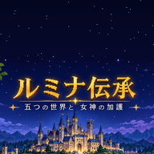

# ルミナ伝承

女神ルミナに えらばれた 勇者が、魔王に おびやかされた 5つの 世界を じゅんに すくう RPG です。
スマホの ブラウザで そのまま あそべます。ホーム画面に 追加すると アプリのように 全画面で 起動し、一度 ひらけば オフラインでも あそべます。



## あそびかた

- **町**：メニューから 宿屋・武器屋・防具屋・道具屋・教会・転職の神殿・酒場などを えらびます。
- **フィールド・洞窟・塔・魔王城**：一人称の 3D 画面で 歩いて 探検します。地図は 歩くと 自動で かきこまれます。
- **仲間**：酒場で 種族（人間・エルフ・ドワーフ・ホビット・獣人）と 職業、性別を えらんで 仲間を つくります。
- **転職**：レベル20に なると 転職の神殿で 上位職に なれます。
- **5つの 世界**：魔王を たおすと 次の 世界へ わたり、レベルは 1に もどりますが、女神の 加護が ひとつずつ ふえていきます。第5の世界では 勇者 ひとりで たびを します。

### そうさ

| | スマホ | パソコン |
|---|---|---|
| 前に すすむ | 十字ボタン 上 | ↑ |
| うしろへ さがる | 十字ボタン 下 | ↓ |
| 向きを かえる | 十字ボタン 左右 | ← → |
| けってい・しらべる | A ボタン | Z / Enter |
| キャンセル・メニュー | B ボタン | X / Esc |

セーブは 町の 教会で 神父に たのむと でき、ブラウザの 中（localStorage）に 保存されます。同じ スマホの 同じ ブラウザで つづきから あそべます。

## ファイルの なかみ

```
index.html              ゲーム本体（HTML・CSS・JavaScript が 1つの ファイルに 入っています）
manifest.webmanifest    ホーム画面に 追加するときの 名前・アイコン・色
sw.js                   オフラインで あそぶための サービスワーカー
assets/                 画像
  portraits.jpg           仲間の 顔（20職業 × 5種族 × 2性別）
  monsters.webp           モンスター（200×200 × 26体を 横一列）
  rulers.jpg              王さまと 魔王
  alliance.jpg            第5の世界の れんごう王
  goddess.webp            女神ルミナ
  tiles.png               フィールド・ダンジョンの かべと ゆか
  gates.png               町・洞窟・塔・ほこら・魔王城の 入口
  title.jpg               タイトル画面
  town1〜5.jpg            各世界の 王都
  selka.jpg               港町セルカ
icons/                  アプリの アイコン
docs/                   公開の 手順など
```

## 公開の しかた

GitHub Pages で 公開します。くわしい 手順は [docs/公開手順.md](docs/公開手順.md) を 見てください。

## ゲームを 更新したとき

`sw.js` の 1行目近くに ある `CACHE` の 名前の 数字を 1つ ふやしてから 公開してください（いまは `lumina-densho-v3` なので、次は `v4`）。
そうしないと、すでに あそんでいる 人の スマホに 古い 画像が のこることが あります。

## 更新の きろく

- **v3**
  - ダメージの 計算を わりあいの しきに かえ、倍率の たかい わざを 下げた。ブレイブスラッシュを 強化（倍率 3.4・かいしん +10%）。
  - 魔王の HPを 上げ（4800、第5の世界は 8000）、回復を 最大HPの 20%に。魔王への じゅもんは 70%。
  - 敵の じゅもん・ブレスが 世界と 敵の つよさに あわせて 強くなるように した。
  - あたらしい じゅもん「マジックバリア」（僧侶 Lv9・勇者 Lv10・騎士 Lv11・魔法使い Lv12）。
  - 階段を ふむと「のぼりますか？」と きくように した（「いいえ」で とおりぬけられる）。
  - 町・洞窟・塔・ほこら・魔王城の 入口を 1マスに した。
  - モンスターの 絵を あたらしく した。

## 使用している もの

- フォント：[Zen Maru Gothic](https://fonts.google.com/specimen/Zen+Maru+Gothic)（SIL Open Font License 1.1、Google Fonts から 読みこみ）
- 画像：作者が 用意した イラストを もとに 作成
- 音楽・効果音：ゲーム内で プログラムにより 生成

## ライセンス

未定（[docs/公開手順.md](docs/公開手順.md) の「ライセンスについて」を 見てください）
